# Ship detailing: from blockout to game-ready textures

The owner, 2026-11-05, on the Ssarith Hunt ships this method made: "Now those my friend are gorgeous looking star
ships", then "Since this is an incredible accomplishment, if like you to write up a skill for detailing space ships with
custom texturing", "Include image samples in your documentation". Written in this repository from that work (provenance:
`.claude/skills/PROVENANCE.md`). It is the binding way to detail and texture a ship. The rules it serves are CLAUDE.md
section 10 and the Ship Design Bible (`docs/design/ship-bible.html`): chapter 9 (hull lighting), 7 (windows), 10
(markings), 13 (culture, not anatomy), 14 (one structure, F1-F5) and 15 (its own texture, T1-T8).

**Take the look, never the art** (CLAUDE.md section 1). The owner's reference sheets are someone else's and are never
committed or traced. What is taken is how such a hull is layered and shaded.

**Nothing from the species' body** (Ship Design Bible C1-C5). A dome is armour, not an eye; a prong is a structure,
not a claw.

## What it took to get here

| Before | Why it failed | The rule now |
|---|---|---|
| 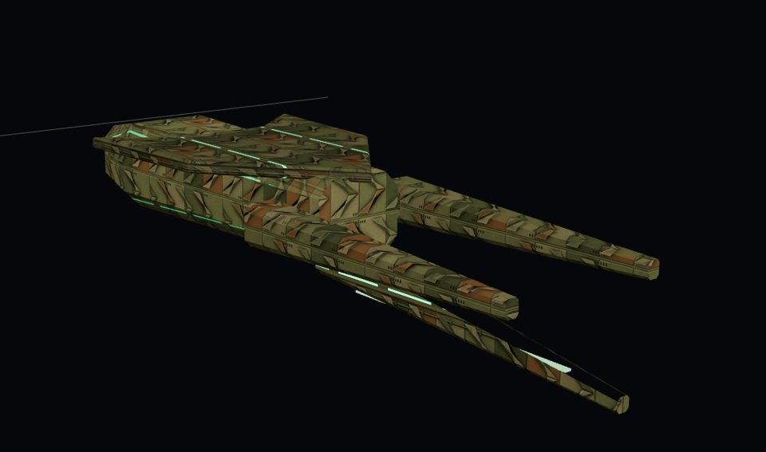 | Boxes, tapered booms and plates placed against each other, one repeating tile over everything (owner: "they arent connect together well, and violate our "no deformed primitive rules"") | F1-F5: one grown skin |
| 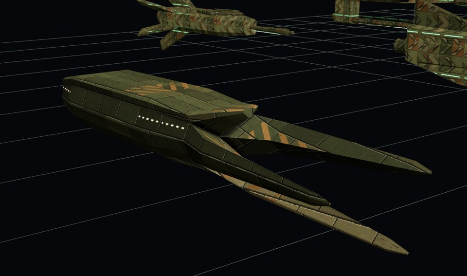 | One skin, its own unwrap, but plain plating that read as brickwork and no features (owner: "armor pieces are square, and there are no distinct features") | T5-T8: modelled, layered detail |
| 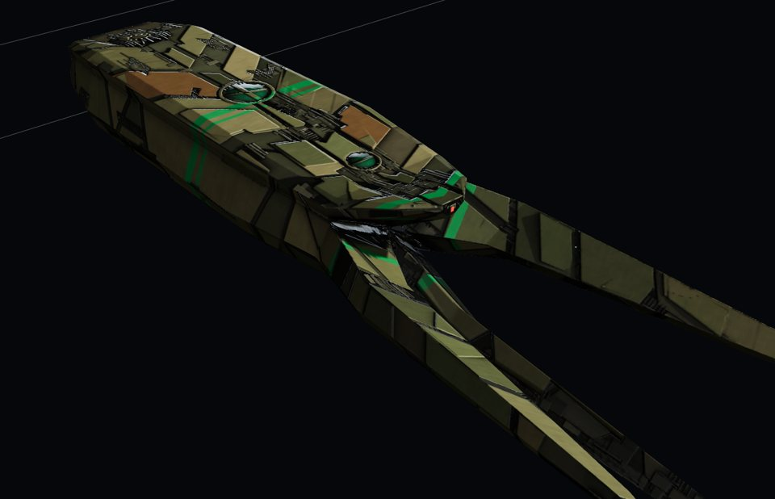 | Layered armour, trenches of machinery, a strapped dome, liveries, the red eye | "gorgeous looking star ships" |

## The pipeline

| Step | Where | Writes |
|---|---|---|
| 1. Grow the hull | the ship's page (`Skin`, `hsec` in `docs/mockups/ssarith-ship-concepts.html`) | the low-poly hull (300-450 triangles) |
| 2. Export it | `tools/mockups/export_blockouts.mjs` | `tools/materials/raw/painted/ships/<ship>.obj` (gitignored) |
| 3. Lay out its detail | `data/ships/<faction>/hull_detail.json` | where every dome, vent, lamp, window row, flood and logo sits |
| 4. The emblem | `tools/mockups/emblem_masks.mjs <faction>` | `assets/emblems/<faction>/hull_mask.{png,json}` from `docs/mockups/lib/emblems.js` |
| 5. Unwrap, build, bake, paint | `tools/blender/painted_bake.py --ship` with `tools/blender/hull_detail.py` | `assets/ships/<faction>/<ship>_{albedo,base,orm,normal,emit,light,ao}.png` and `manifest.json` |
| 6. Show it | `tools/mockups/inline_data.py` on the page | the page's Painted, PBR and Clay looks under Studio or Night light |

```sh
NODE_PATH=$(npm root -g) node tools/mockups/export_blockouts.mjs
NODE_PATH=$(npm root -g) node tools/mockups/emblem_masks.mjs ssarith
/opt/blender/blender -b --python tools/blender/painted_bake.py -- --ship hooded_lance --px 1024 --samples 16   # iterate
/opt/blender/blender -b --python tools/blender/painted_bake.py -- --ship hooded_lance,forked_prow --px 2048 --samples 32   # commit
python3 tools/mockups/inline_data.py docs/mockups/ssarith-ship-concepts.html
```

A full bake costs about 12 minutes a ship at 2048 px on 4 cloud cores, so bake at most two ships per background job (a
job is stopped at 30 minutes). Iterate at 1024 px and 16 samples (about 1.5 minutes a ship).

## 1. Grow the hull as one structure

The low-poly hull is the silhouette and the thing the game hits. It is one closed skin (Ship Design Bible F1-F5):

- **One section layout.** Every station of the body is the same 18 points, counter-clockwise from the keel's bottom
  centre: keel corner, keel root, bottom chine, lower side, side chine (it can swell out), hood root, hood edge, hood top,
  crown, and their mirrors (`hsec`: `hb`, `top`, `bot`, `ch`, `sw`, `hw`, `ht`, `kd`, `kw`, `cr`). A feature a station
  lacks lies flat in its neighbours' line, so every station lofts to every other point to point.
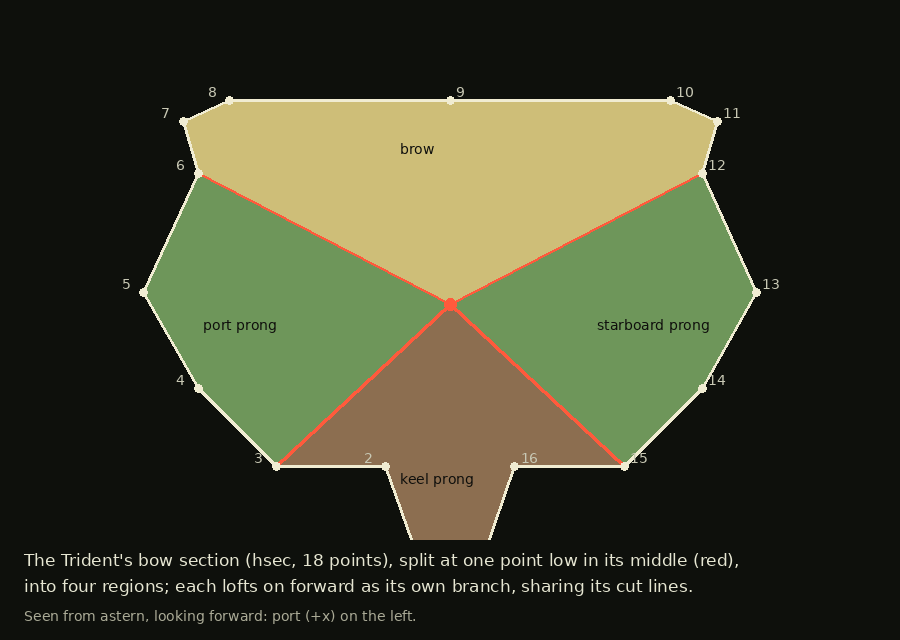

- **Branches split from the body's own section.** At the bow the last section is cut along lines (`cutLine`, `seg`) into
  regions; each region lofts on as a named branch (`K.branch(name, region, z, [[dz, sx, sy, dx, dy], ...])`), scaled and
  moved station by station, and capped. Two branches that split from one section share their cut line, so the skin never
  opens or overlaps. The Trident splits from one point low in its middle into a brow, two side prongs and a keel prong;
  the Harpoon's rail is its keel run on past the bow.
- **Details are skin.** A light strip is a face of the skin (`glow(k)` picks the edges); the drive is a recess cut into
  the stern. Nothing is placed on top.
- Every branch has one job and a name (the hood, the lance, the keel blade).

## 2-3. Export it and lay out its detail

`export_blockouts.mjs` asks the page for its picks (`MOCKUP_PICKS`) and their OBJ (`MOCKUP_EXPORT_OBJ`), in ship space
(+x port, +y up, +z bow, metres), one object per part, strips as `glow_*`. Blender imports it with forward Y, up Z, so
nothing is converted and Blender's object space is ship space.

`hull_detail.json` holds the layout, one entry per ship, and the defaults every ship shares. A feature is placed by a
ray: `face` (`top` from above at `[x, z]`, `bottom` from below, `port` from the port side at `[z, y]`, `bow` from ahead
at `[x, y]`). Anything off the centreline is mirrored to starboard.

| Key | What | Ssarith numbers |
|---|---|---|
| `defaults` | armour 0.5 m thick, sub-armour 0.22 m, plate lift up to 0.35 m, gaps 0.5-1.0 m, trenches 2.6-4.6 m in 40 % of cuts, overlays on plates over 22 m2 (drawn in to 0.86, lifted 0.3 m), 1.6 greebles a m2, `light_ref` 0.9 | |
| `domes` | `r_m`, `h_m` (how far it stands proud), `straps` [[angle, width]] | r 2.6-6.4 m |
| `fans` | `r_m`, `fins`, `lamps`, `tilt_deg`, `lamp` colour | r 3.8-4.6 m, 13-21 fins |
| `louvres` | `shape` chevron or slot, `len_m`, `span_m`, `w_m` or `rake_m`, `pitch_m`, `slant_deg` | four a ship, each its own |
| `lamps` | `size_m`, `colour`, `housing` (the eye lamp's two steps) | |
| `exposed` | plan polygons and a y range where the armour is left off (the stern deck round a fan, the neck) | |
| `liveries` | `band_z_m` bands, `chevron` stripes (`z_m`, `sweep`, `w_m`) | green, 0.6-1.4 m |
| `logo` | `at` [x, z] on the top armour, `size_m`, its flood's `flood_w` | 5-7 m |
| `lighting.floods` | spotlights 0.9 m off the hull, grazing it toward `aim`, 90 degree cones | three a ship |
| `windows` | `z_m` stretch and `rows_y_m` deck heights on the port flank | provisional until the room plan |

## 4. The detail layer (`hull_detail.py`)

Built over the low-poly hull, in ship space, never exported: it exists only to be baked.

- **Under layer**: a copy of the hull, near black; its strip faces keep their own material. *Read which faces are strips
  before clearing the copy's materials: Blender zeroes every face's material index when you clear them.*
- **Primary armour**: the hull's faces grouped by facing (top, bottom, port, starboard; bow and stern faces and the
  crotches between branches carry none), thickened outward (Solidify), and cut apart by one Exact boolean against a
  joined cutter of thin slabs along the gap lines: on top and bottom a kinked spine and swept chevrons, every station's
  spacing, sweep and spine width drawn from the ship's seed; on the flanks raked cuts and a chine line in some bays; plus
  the data's exposed areas and every feature's hole. Split into plates (separate by loose parts, slivers dropped); each
  plate raised along its facing by its own amount; plates over 22 m2 get an **overlay**, the plate copied, bisected by a
  raked line, the cut filled, drawn in and lifted, so the armour steps up in layers.
- **Sub-armour**: the same with a thinner shell, its own cuts and wider gaps, so trenches show a second layer.
- **Greebles** only where both armour layers leave the hull bare: points sampled over the hull, kept if a ray up from
  them finds no armour within 0.9 m; blocks, sub-armour slabs, pipe runs and rib sets, each seeded by where it is.
  **Never inside an opening**: a greeble with any vertex inside a hole cutter (a window, a bay, a fan's or dome's well)
  is dropped, or it stands in front of the pane and the bake hides the room behind it (v15's first bake: ragged bays).
- **Features**, each sitting in a hole cut for it: domes (a sphere sunk to stand h proud, a collar ring, straps that hug
  it: a slightly larger sphere intersected with a slab), fans (recess, hub, tilted fins, a lamp ring), louvres (a convex
  outline or two cut through, slats tilted and clipped to the outline with `bisect_plane`), lamps (the eye lamp in a
  two-step housing), windows (1.1 by 0.6 m, groups of 4-12 at 1.6 m pitch, rows 3.5 m apart, about one in five dark).
- **Fixtures** (Ship Design Bible chapter 9): the data's hull floods and the logo flood; a belly pair one forward one
  aft; position lights at the widest frame (port red, starboard green) and white aft; red beacons top and bottom
  mid-ship; white strobes at the bow's tips. Each gets a small lit lamp on the hull and a light for the bake, named
  `LIGHT_<kind>_<n>` (the light-baking skill), and is written to the manifest so the page can blink it.
- **Forward floods** (owner: "we need some more lights pointed forward to paint more of the hull"): `auto_floods` adds rows
  of floods aimed forward along the port flank (mirrored), the top and the belly, every 22 m from the stern to the bow's
  split (`to_z_m`), 1.8 kW in 80 degree cones, 0.9 m off the plating and tilted 12 degrees into it.
- **Panes** (owner: "we need to show interior of ships with windows"): every window and launch bay is a pane. Its glass
  is a thin box in the detail layer (it glows when lit, so it lights the hull round it), and `pane_box` writes its entry
  to `PANES`: room kind (quarters, mess, workshop, hold or bay), lit or dark, size, centre and axes. The baker writes them
  into the manifest (`panes`), and the page draws each pane as its own quad from them (below). A window group shares one
  room kind. Never bake the panes into a map: a 1.1 m window is about 17 texels at 2048 px, so its edge comes out ragged
  (owner, 2026-11-05: "windows and hangar bay are kinda messed up, mmake them clean, make the border clean"). Bays (`bays` in the
  data: `w_m` wide by `h_m` tall) are cut through the armour like windows, with
  amber lamps along the lintel. A bay's width always runs level: on a face whose frame runs up the ship (a bow face) its
  frame turns a quarter about the normal, or the mouth comes out on its side.
- **Every pane lies flat on its face, frame and all** (`fits`: each corner and edge middle of the framed rectangle within
  0.12 m of the face's plane). A window that would cross a bend is left out (Ship Design Bible W2); a bay that does not fit
  stops the build, naming it, so the data moves it (owner, 2026-11-05: "hanger window taller than side of the ship": the
  flank bays were 5 m on a face 5.3 m tall, off centre). The frame widths are data (`pane_frame_m`), written into each
  pane, so the check and the page use one number.
- **One axis of symmetry, nothing repeated**: everything off the centreline is built on the port side and mirrored with a
  reflected frame (`frame_at(p, n, mirror=True)`, faces reversed by `place`); every piece's `rid` is a hash of its
  mirrored position (`rid_of`), so a plate and its mirror take the same paint and no two others do.

## 5. The bake

Join the whole detail layer into **one object** first (the bake's setup is per object: 600 pieces cost a minute a pass,
one costs seconds). Select it, make the low-poly hull active, hide the hull from rays (`visible_shadow`, `visible_diffuse`,
`visible_glossy` off), and bake selected-to-active, cage 1.3 m, ray 2.8 m, margin 8 px. Every detail material is one
node graph switched per pass (`kind_material`, `show`).

| Pass | Bake type | What it gives | Seconds at 1024 / 2048 |
|---|---|---|---|
| data | EMIT | kind code, piece id (`rid`), edge amount (Bevel node, armour rolled 0.3 m) | 10 / 40 |
| glow | EMIT | each lamp's and window's colour | 1 / 4 |
| position | EMIT | ship-space position, for liveries, logo and strips | 2 / 6 |
| normal (object) | NORMAL | the paint's own lighting | 11 / 45 |
| normal (tangent) | NORMAL | the normal map for the game and the page | 12 / 45 |
| AO | AO, 2.2 m | occlusion, deep in the trenches | 12 / 90 |
| sun | DIFFUSE direct | a low painter's sun (ship space 0.6, 0.55, 0.58) with its cast shadows | 8 / 60 |
| hull lights | DIFFUSE direct, sun off, fixtures on | the floods', lamps' and windows' light falling on white plating | 15 / 120 |

## 6. The maps

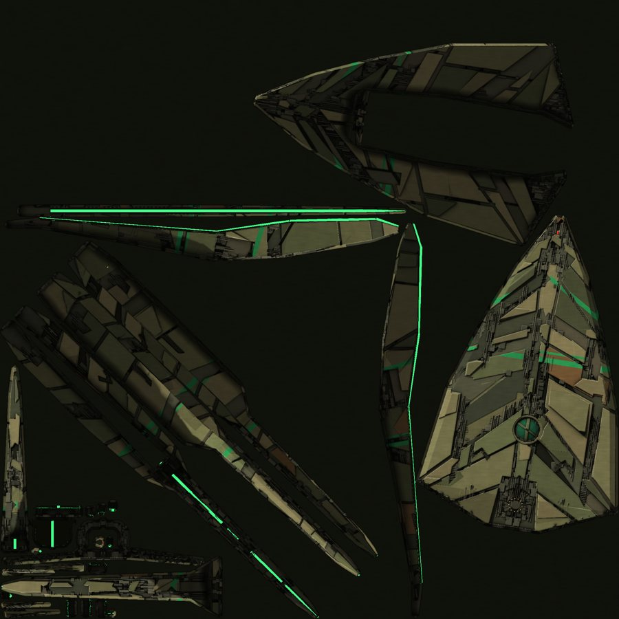

One unwrap (Smart UV Project at 60 degrees, then `pack_islands` CONCAVE with rotation; about 110-165 m of hull per UV
unit) carries every map. Everything starts from **one flat paint** (`flat_paint`): each texel coloured by its kind
(armour from a palette of olives and khakis by its plate's id with one bronze accent, sub-armour greyer, the under layer
near black, greebles, the dome's green, slats, vents), the liveries, and the emblem on a patch of its own plate colour.

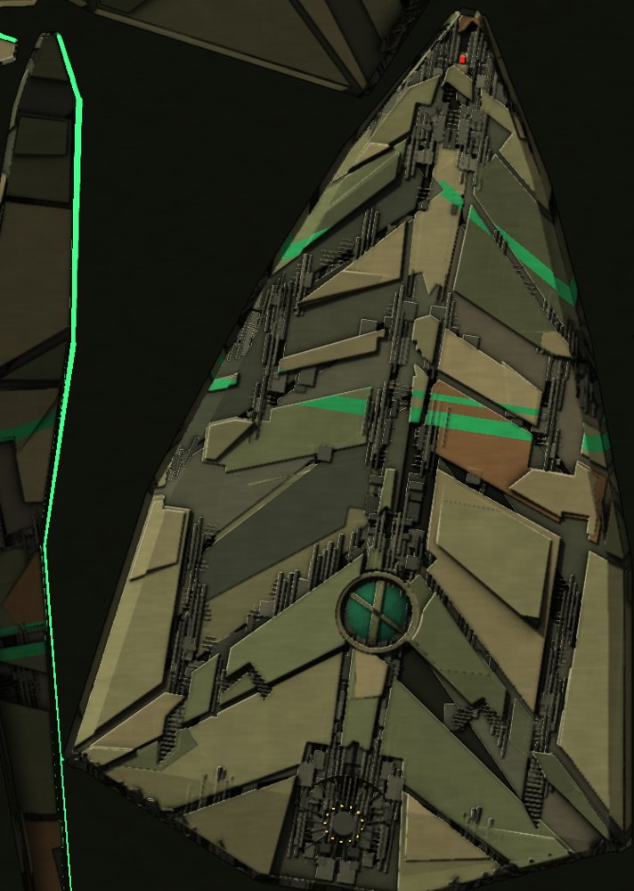

| Map | Built by | What is in it |
|---|---|---|
| `albedo` (Painted) | `paint_ship` | the flat paint lit the way a painter lights it: the sun in soft steps over a low ambient, AO curved and inked, plates pillowed darker toward their gaps, lit and shaded edges, the dome's highlight, grain |
| `base` (PBR) | `paint_pbr` | the flat paint with no light: cavities kept dark (AO), plates a little darker toward their gaps, worn edges lighter, grain |
| `orm` (PBR) | `paint_pbr` | red AO, green roughness, blue metalness by kind (`PBR`), paint less metallic, worn edges smoother and barer |
| `normal` | the tangent bake | the detail's relief, OpenGL convention |
| `emit` | `strips_and_glow` | lamps, windows, the strips' lit line (0.7 m) in its dark channel, the domes' faint inner light, a soft halo |
| `light` | the hull lights bake | the light falling on the hull, over `light_ref`, stored with a 1/1.6 curve at half size |
| `ao` | the AO bake | kept beside, not inlined (it is in the ORM and the paint) |

The Hooded lance's hood in every map (from the top: the emblem on its plate, the dome, the fan at the stern deck; the
light map here brightened 1.6 times to read):

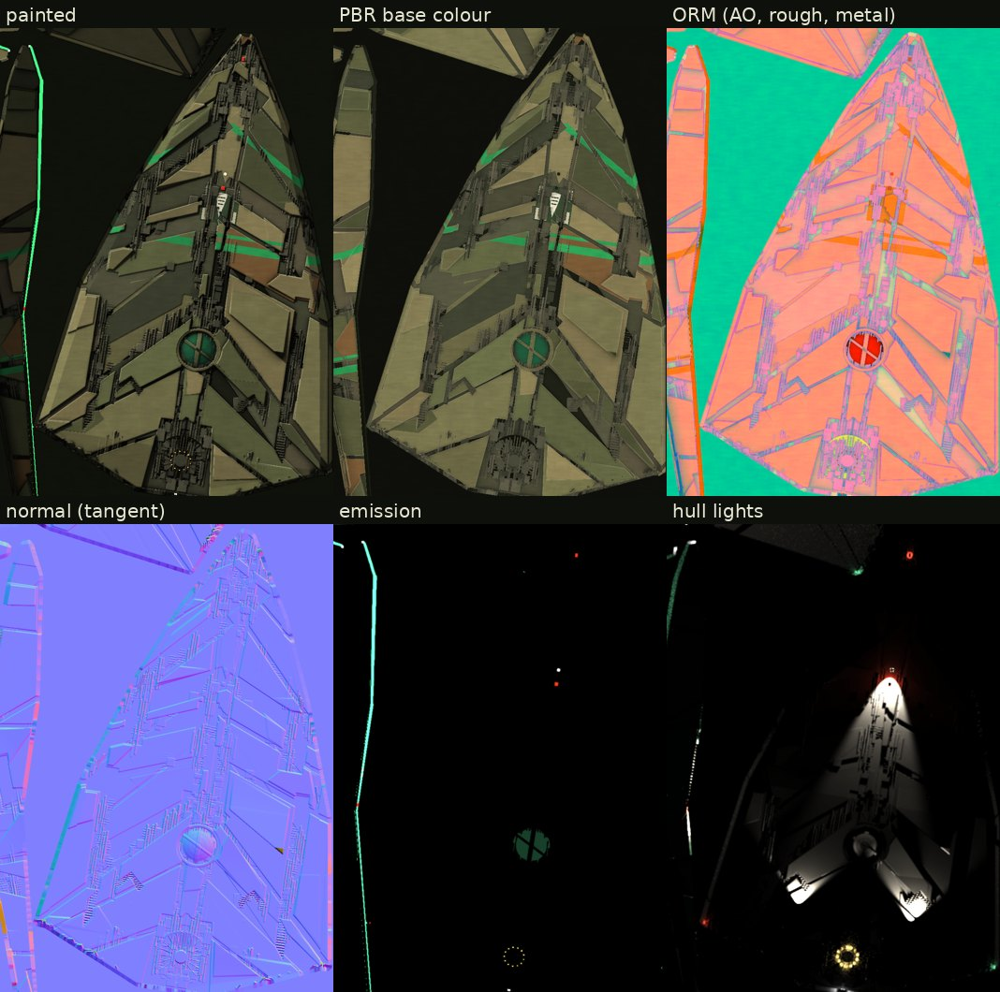

## 7. On the page

The page shows the UV mesh from the manifest (indexed, `uv2 = uv` for the AO map, tangents computed) with two materials
over one geometry: **Painted** (the painted map, its own light kept as a third of its emission, no environment) and
**PBR** (base, ORM, tangent normals, under the live light and a soft room environment). Both add the light map
(`diffuse x light^gamma x k`) and the emission. **Studio** and **Night** set the live lights, the light map's strength
and the environment; at night the ship is lit by its own floods, lamps and windows. Strobes flash twice every 1.5 s,
beacons pulse, position lights and floods burn steady, as additive sprites at the fixtures; a shot fixes the clock.

| PBR, Studio | Night |
|---|---|
| 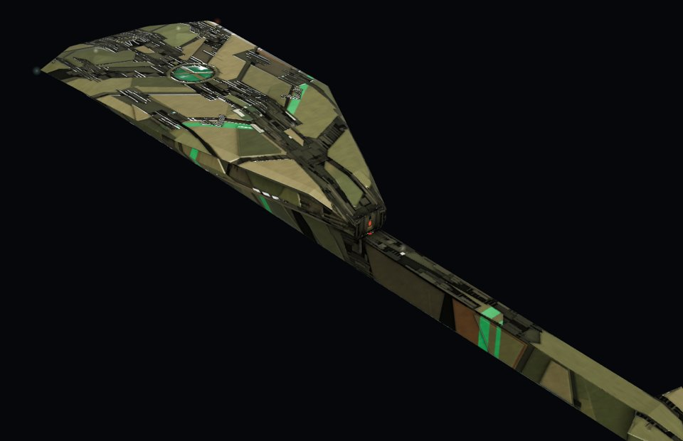 | 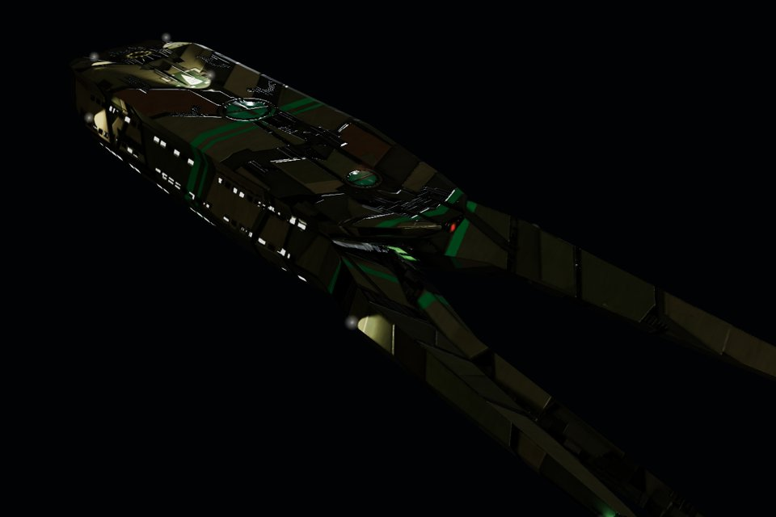 |

The board at night, each ship lit by its own floods, lamps, windows, strobes and beacons:

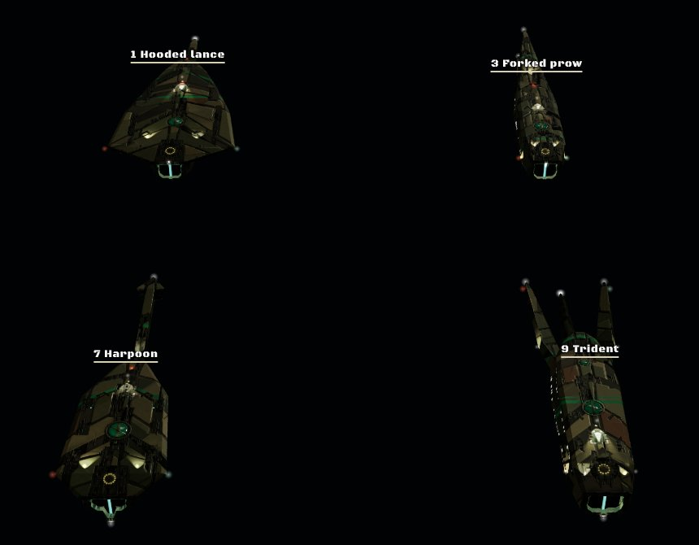

### Rooms, hangars and damage on the page

**Rooms behind the panes.** Each ship's panes are one mesh of quads (`paneMesh`), laid 5 cm off the hull at the place
the bake cut for each pane, each quad the pane plus its frame (0.1 m round a window, 0.35 m round a bay). Every vertex
carries the pane's place in metres, its half size, its axes and its kind, so the frame is exact at any distance: a
bevelled rim of the hull's dark metal lit from above, a fine lit line round the glass. Behind a window's glass the view
ray draws the room with `roomBehind(q, D, room, kind, light)` from `docs/mockups/lib/ship-rooms.js` (the same rooms as the
Concord line's), in a frame **level with the decks**, not the face's: up is the ship's up, in is the face's normal turned
level, and the pane cuts the room's front at a slant (owner, 2026-11-05: "Need to account for normal angles on windows, and the hangar bay too").
The quads share the ship's damage uniforms, so a hole or a burn takes its panes with it.

**Hangars are painted too, by parallax** (owner, 2026-11-05: "I actually like the paralax so I'd keep it", after
weighing geometry: "Hangar bay is large enough for me to just recommend using geometry"). `hangarBehind(q, D, room, mouth,
light)` draws the deck, stripe, parked craft, ceiling lights, ribbed walls and back wall behind a bay's open mouth, in the
same level frame as the rooms, its mouth measured level (on a sloped flank the mouth is shorter than the bay is tall). A
hole or a burn takes the pane, and the hole's own decks show through it.

**Damage**, on the shared `docs/mockups/lib/ship-fx.js` (as the Concord and Krai pages): the hull shader runs
`dmgHoles`, `dmgScorch` and `interiorRoom` (holes show the decks behind), per-ship damage uniforms; a phaser scorches, a
torpedo blows a hole and leaves an emitter (fire, smoke, embers) stepped by `emitterStep`. The shared GLSL declares
`uLight`, so a ship's own light map is `uHullLight`.

| The carrier's bays | Night with the rooms lit | A torpedo's work |
|---|---|---|
| 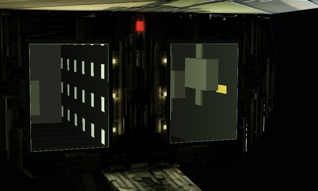 | 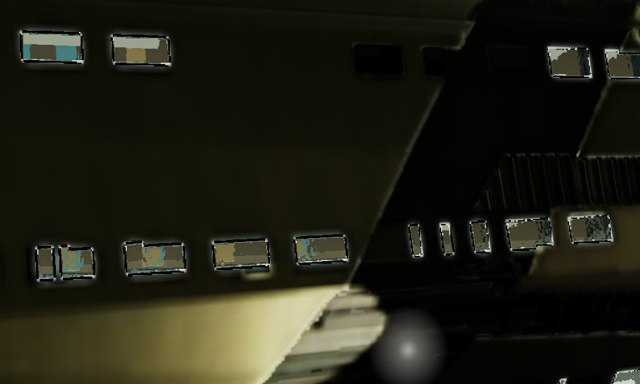 | 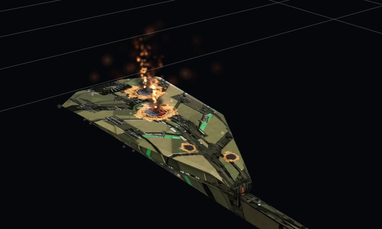 |

## Judge it

Look at the maps and at the ship close up and from the board, in every look and both lights:

- **Silhouette first**: in clay, the hull is one structure and every branch grows from it (F1-F5).
- **Layers**: plates of different outline and height, overlays on the big ones, sub-armour and machinery in the
  trenches. If the gaps are hairlines, widen them and add trenches; the detail must read at ship scale.
- **Features**: each ship has its dome, fan, shaped vents, eye lamp, liveries and emblem; none is a copy of another.
- **Symmetry**: from above, port and starboard mirror plate for plate and colour for colour.
- **Shading**: the trenches are deep, the plates' edges catch the light, the plates stand proud.
- **Lights at night**: the floods pool on the plating without overlapping (L2), the windows read in rows, strobes and
  beacons blink, nothing glows that has no reason to.
- **No seam** shows as a hard colour jump; no z-fighting where a lamp meets the hull.

## Pitfalls hit

| You see | Cause | Fix |
|---|---|---|
| Every gap between plates glows | A mesh copy's materials cleared: Blender zeroes every face's material index | Read which faces are strips before clearing |
| Each bake pass takes minutes | Hundreds of separate objects selected to active | Join the detail into one object first |
| The detail is too fine to read at ship scale | Hairline gaps, small features | Trenches of 2.6-4.6 m in about 40 % of the cuts, domes and fans of 4-6 m, overlays on the big plates |
| The plating reads as brickwork | Plates one length, joints staggered by half | Every station's spacing and sweep its own, from the seed |
| Hundreds of tiny UV islands, empty texture | A hull of placed primitives, every face at an angle to its neighbour | Grow the hull as one structure; pack the islands again by shape |
| A light strip glows metres wide | The keel's whole flat bottom is the strip face | A dark channel with a lit line down its middle |
| The logo cannot be seen | Its field colour matches the khaki plates | Paint the emblem's own plate colour as a patch under it |
| The light map is speckled | The lamps' and windows' faces sampled as lights | More samples (32), a one-pixel blur |
| Window and bay borders ragged, rooms speckled | The panes read from a baked map a few texels across | Draw each pane as its own quad from its data (`paneMesh`) |
| Rooms stippled, lit and dark pixels mixed | A per-vertex kind like 8.0 interpolates to 7.9999 and floors to the wrong kind | Round it in the shader (`floor(vKind + 0.5)`) |
| The hull shader will not compile on a damage page | Your uniform has a name the shared GLSL already declares (`uLight`) | Name yours apart (`uHullLight`) |
| The page never becomes ready | A ship in the manifest lacks a map the page asks for | Bake every ship before inlining, or keep the old manifest |
| A flat olive hull | Only the per-part paint, nothing modelled | The detail layer of step 4 |

## Into the game (when the mockup is approved for implementation)

The PBR set maps onto glTF directly: `base` as baseColorTexture, `orm` as metallicRoughnessTexture and
occlusionTexture, `normal` as normalTexture, `emit` as emissiveTexture; the light map goes in as a second emission
layer or a UV2 light map (the light-baking skill), and the fixtures as named `LIGHT_<kind>_<n>` empties so the game can
blink the strobes and darken a lamp when its section loses power. The low-poly hull's triangles and the maps' sizes go in
the ship's manifest against its budget (CLAUDE.md section 10, mid detail, mobile budgets).
